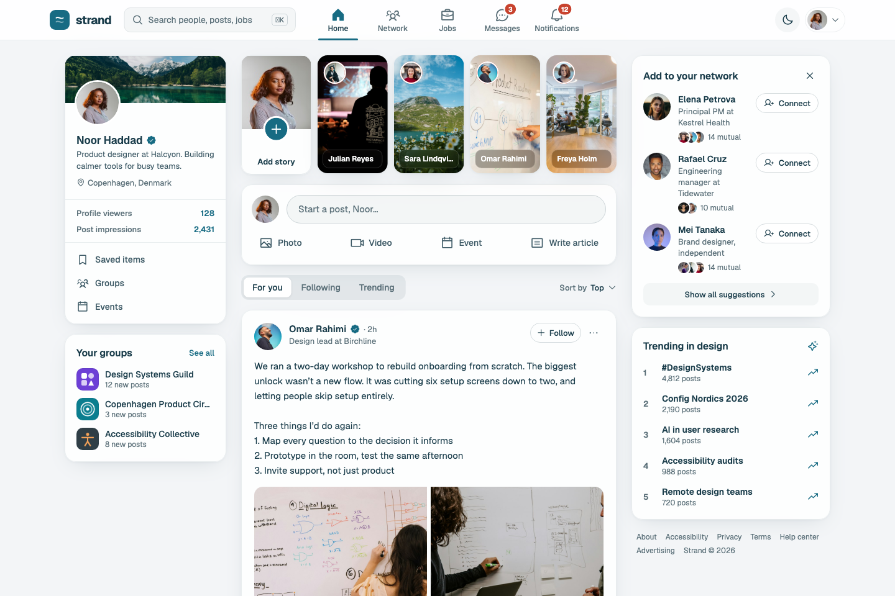

# Demo

A small professional network, built entirely from
[una](https://github.com/vlidholt/una) widgets: a home feed with
stories, posts and comments; jobs with filters, an Easy Apply stepper and a
board of your applications; messages with an assistant that streams its
replies; a profile, notifications, search and settings. Everything in it is
invented, and nothing you do is sent anywhere.

**Try it:** <https://vlidholt.github.io/una_demo/>



It is the app `una`'s default look was measured from, and it follows
the theme's form factor: one layout for a desktop window, another for a
phone, and a navigation rail in between. For the documentation of every
component, with live previews and a theme editor, see the
[component library](https://vlidholt.github.io/una/).

## Running it

```bash
flutter pub get
flutter run -d chrome
```

It also runs on macOS, Windows, Linux, iOS and Android once the platform
folder is added (`flutter create . --platforms macos`). Text is set in
[Geist](https://vercel.com/font), fetched at runtime by `google_fonts`; on
macOS that needs the `com.apple.security.network.client` entitlement in
`macos/Runner/DebugProfile.entitlements` and `Release.entitlements`.

### Against a local una

`una` comes from git (`main` of `vlidholt/una`, pinned by
`pubspec.lock`). To work against a checkout next to this one, create a
`pubspec_overrides.yaml` (it is gitignored):

```yaml
dependency_overrides:
  una:
    path: ../una
```

## Tests

```bash
flutter analyze
flutter test --timeout 120s
```

## Layout

| Path | Contents |
| --- | --- |
| `lib/main.dart` | Entry point: the theme (the package default, set in Geist) and the app-wide providers. |
| `lib/demo_shell.dart` | The app's chrome: top bar, navigation rail or bottom bar, around the selected destination. |
| `lib/screens/` | One screen per destination, plus Search and Settings. |
| `lib/widgets/` | The screens' pieces, named after the screen they belong to. |
| `lib/data/`, `lib/data.dart` | The invented people, companies, posts, jobs and conversations. |
| `lib/session.dart` | State more than one screen shows: notifications, messages, saved jobs. |
| `assets/images/` | The pictures, exported from the design files. |
| `test/` | Widget tests per screen, theme-coverage and frame-cost checks. |

## Licence

MIT; see [LICENSE](LICENSE).
